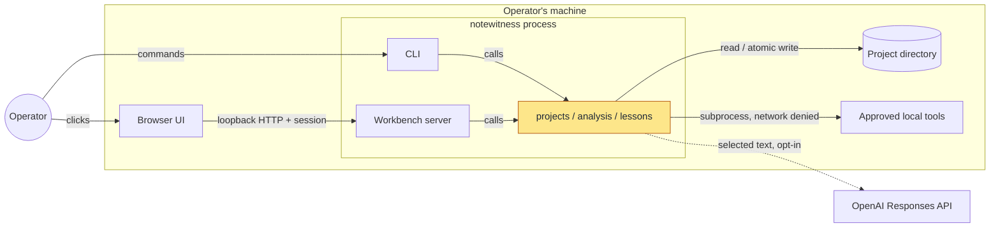
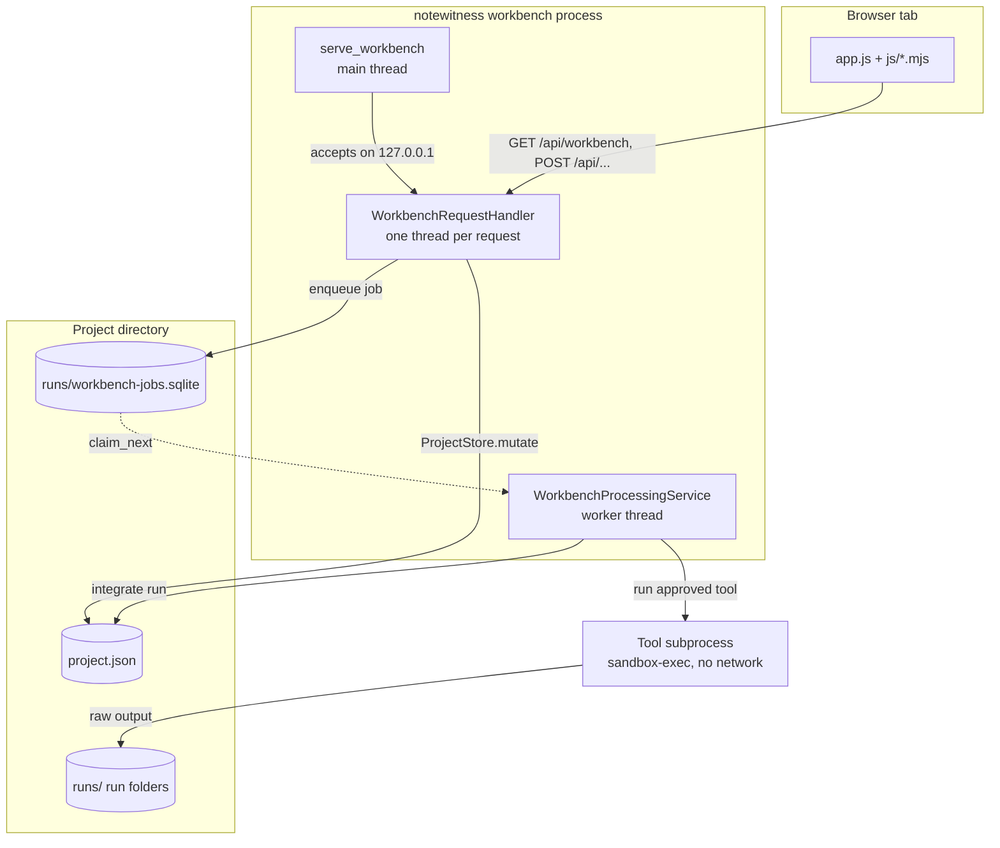
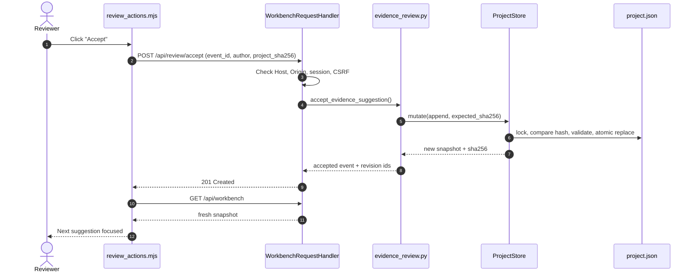
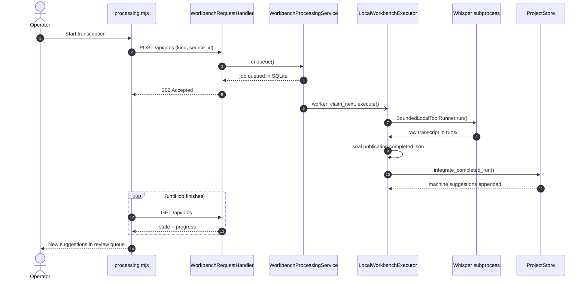
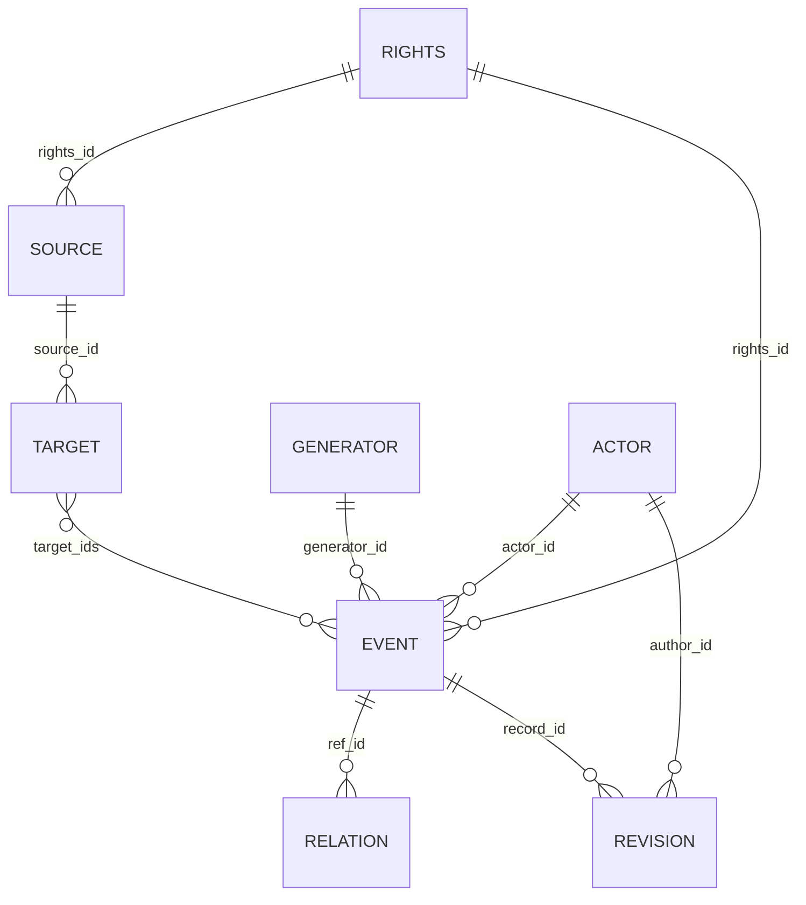
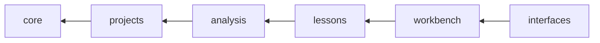
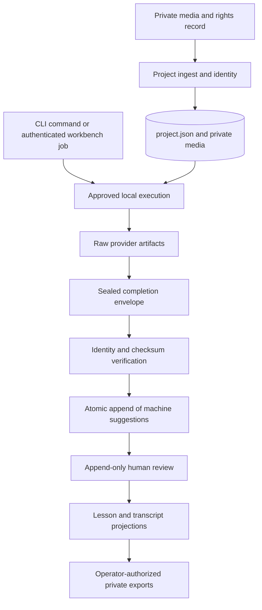
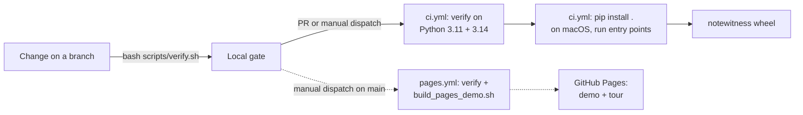

# Architecture

NoteWitness turns private music-lesson recordings into provenance-linked
evidence, review decisions, lesson projections, and exports. It ships as one
installable Python distribution that runs as one local process — not a set of
services. The only separately deployed piece is the browser-only mock-data demo
on GitHub Pages.

## System context

Who uses NoteWitness, and what does it talk to?

The CLI and the workbench compose the same project, analysis, and lesson
features. The browser holds no separate authority: it can call only the
operations the loopback server exposes, and it cannot supply executable, model,
score, or arbitrary filesystem paths. The OpenAI edge is the only network
traffic and stays off unless the project policy and the operator allow it.

Where in the code: [interfaces/cli/main.py](../src/notewitness/interfaces/cli/main.py),
[workbench/server.py](../src/notewitness/workbench/server.py),
[lessons/openai_responses.py](../src/notewitness/lessons/openai_responses.py).

## How it runs

What runs where once `notewitness workbench <project>` starts?

`serve_workbench` builds a `LocalWorkbenchServer` (a standard-library
`ThreadingHTTPServer`) bound to `127.0.0.1`, opens the browser on a single-use
launch URL, and serves until Ctrl-C. Every request gets its own handler thread;
reads build a fresh snapshot from `project.json`, writes go through
`ProjectStore.mutate`. Only when `--runtime-config` is given does the server
create a `WorkbenchProcessingService`, which takes the project's processing
lock and starts one background worker thread. That worker claims jobs from
SQLite and launches each approved tool as a bounded child process. There is no
separate daemon, database server, or build step: the browser assets are static
files shipped inside the package.

CLI commands (`init`, `validate`, `analyze-local`, `analysis-job`, ...) run in
the same packages but as one short-lived process each, with no server.

Where in the code: [workbench/server.py](../src/notewitness/workbench/server.py),
[workbench/http.py](../src/notewitness/workbench/http.py),
[workbench/processing.py](../src/notewitness/workbench/processing.py),
[workbench/jobs.py](../src/notewitness/workbench/jobs.py),
[analysis/local_tools/runner.py](../src/notewitness/analysis/local_tools/runner.py).

## User journeys

### Accepting a machine suggestion

What happens when a reviewer clicks **Accept** in the review queue?

The browser sends the hash of the document it was showing (step 2); if anyone
else changed `project.json` since, step 6 rejects the write with a conflict
instead of overwriting it. Acceptance never edits the machine event: the
`append` callback adds a new `human_accepted` event that points back to the
suggestion through `source_suggestion_id`, plus an `adjudicate` revision. The
UI then reloads the whole snapshot (step 10) rather than patching local state.

Where in the code: [assets/js/review_actions.mjs](../src/notewitness/workbench/assets/js/review_actions.mjs)
(`acceptSuggestion`), [workbench/http.py](../src/notewitness/workbench/http.py)
(`do_POST`, `_dispatch_post`), [workbench/api.py](../src/notewitness/workbench/api.py)
(`_accept_review`), [lessons/evidence_review.py](../src/notewitness/lessons/evidence_review.py),
[projects/store.py](../src/notewitness/projects/store.py) (`mutate`),
[workbench/snapshot.py](../src/notewitness/workbench/snapshot.py) (`project_workbench`).

### Running a transcription job

What happens when the operator starts speech transcription from the workbench?

The HTTP request only queues the job (steps 2–5); the work happens on the
worker thread (step 6), so a slow model never blocks the UI. The tool writes
into its own run folder, and nothing reaches `project.json` until the sealed
envelope is verified and appended in one transaction (steps 9–11). Everything
the job adds is `machine_suggested`; it shows up in the review queue from the
previous journey. The analysis-suite stages follow the same shape through
`LocalWorkbenchExecutor._analyze`.

Where in the code: [assets/js/processing.mjs](../src/notewitness/workbench/assets/js/processing.mjs),
[workbench/api.py](../src/notewitness/workbench/api.py) (`_enqueue_job`),
[workbench/processing.py](../src/notewitness/workbench/processing.py) (`enqueue`, `_work_loop`),
[workbench/executor.py](../src/notewitness/workbench/executor.py) (`execute`, `_transcribe`),
[analysis/transcription/runtime.py](../src/notewitness/analysis/transcription/runtime.py),
[analysis/transcription/whisper_cli.py](../src/notewitness/analysis/transcription/whisper_cli.py),
[analysis/runs/publication.py](../src/notewitness/analysis/runs/publication.py),
[analysis/runs/integration.py](../src/notewitness/analysis/runs/integration.py).

## Data model

What is stored in `project.json`, and how do the records refer to each other?

The document holds eight collections (`COLLECTIONS` in
`core/evidence/contract.py`). A **source** is a recording with its **rights**
record; a **target** selects a span of it; an **event** is one observation
(speech, music, ...) over targets, made by a **generator** (`human`, `machine`
or `import`) and attributed to an **actor**. **Relations** link events
(`demonstrates`, `feedback_on`, ...), and **revisions** record every human
decision against a record. Review status and evidence layer
(`raw_model_output` → `normalized_hypothesis` → `accepted_annotation`) live on
each event, which is how machine output and human review stay separate in one
file. The [JSON Schema](../schemas/v0.1/evidence-graph.schema.json) is the
full contract.

Other state lives next to the document:

| Path in the project | Holds | Written by |
|---|---|---|
| `project.json` | The evidence graph above | `projects/store.py` only |
| `media/` | Ingested recordings, checksummed | `projects/media.py` |
| `runs/<run-id>/` | Raw tool output, status files, sealed publication envelope | `analysis/runs/*` |
| `runs/workbench-jobs.sqlite` | Workbench job queue, attempts, step checkpoints | `workbench/jobs.py` |
| `runs/analysis-jobs.sqlite` | CLI analysis-suite leases and checkpoints | `analysis/suite/job_store.py` |
| `exports/` | Operator-authorized transcript and music exports | `lessons/*_export.py` |

Where in the code: [core/evidence/contract.py](../src/notewitness/core/evidence/contract.py),
[core/evidence/validation.py](../src/notewitness/core/evidence/validation.py),
[projects/initialize.py](../src/notewitness/projects/initialize.py),
[examples/synthetic-lesson/project.json](../examples/synthetic-lesson/project.json)
(a small real document to read alongside).

## Packages and the authority gradient

The six packages follow the authority an operation needs, from pure values to
the delivery surfaces:

| Package | Responsibility | State and side effects |
|---|---|---|
| `core` | Evidence graph contract and validation; time, audio, transcription, analysis, lesson, and export value rules; strict JSON helpers | None; standard-library-only and side-effect free |
| `projects` | The owner-private storage boundary: private filesystem and SQLite primitives, project creation, `project.json` persistence and atomic mutation, media ingest, private artifacts | Sole mutator of `project.json`; owns `media/` |
| `analysis` | Machine hypotheses: bounded local execution, the transcription and analysis-suite pipelines, and the shared run workspace, publication, and integration | Owns `runs/` artifacts and `runs/analysis-jobs.sqlite` |
| `lessons` | Human decisions and their projections: append-only review rules, actors, capture records, lesson notes, transcript and music exports, opt-in remote text suggestions | Mutates evidence only through `projects`; writes guarded exports |
| `workbench` | Loopback HTTP, session and request security, browser assets, operator runtime configuration, and browser-requested processing jobs | Owns `runs/workbench-jobs.sqlite` and the processing lock |
| `interfaces` | CLI composition, the capability registry, and the installed provider-bridge executables | Outer composition boundary |

Security invariants are stated against this gradient: only `projects` writes the
canonical document, automatic output from `analysis` stays machine-suggested,
and only `lessons` turns it into human evidence or an export.

### Where each feature lives

| Feature | Modules |
|---|---|
| Evidence graph | `core/evidence/*` (contract, graph, validation); public API `notewitness.evidence`; loading in `projects/document.py`, persistence in `projects/store.py` |
| Private storage | `projects/private_fs.py` (pinned directories, no-follow walks, identities), `projects/private_sqlite.py` (hardened SQLite files), `projects/artifacts.py` (exclusive private writes) |
| Media ingest and capture | `projects/media.py`; browser capture records in `lessons/capture.py`; HTTP streaming in `workbench/media.py` |
| Bounded local execution | `analysis/local_tools/*`; `launcher.py` is executed by path and stays self-contained |
| Transcription | Values in `core/transcription/*`; Whisper adapter, runtime, and evidence in `analysis/transcription/*`; review in `lessons/transcript_review.py`; export in `lessons/transcript_export.py` |
| Analysis suite | Values in `core/analysis/*`; adapter, protocol, identity, evidence, one-shot runtime, resumable coordinator, checkpoints, job store, and job orchestration in `analysis/suite/*`; reference provider executables in `interfaces/bridges/*` |
| Run lifecycle | `analysis/runs/workspace.py` (run directories, media resolution, identities, status), `publication.py` (sealed envelope), `integration.py` (verification and atomic append) |
| Review and actors | `lessons/review_rules.py`, `lessons/evidence_review.py`, `lessons/actors.py` |
| Lesson projections | `core/lesson/model.py`, `lessons/lesson_notes.py`, `lessons/lesson_projection_*.py`, `lessons/pedagogical_digest.py`, `analysis/speaker_alignment.py`, `workbench/timeline.py`, `workbench/snapshot.py` |
| Exports | `core/exports.py` (loss gates), `lessons/music_export*.py`, `lessons/transcript_export.py` |
| Remote suggestions | `lessons/network.py` (bounded transport), `lessons/openai_responses.py` |
| Workbench processing | `workbench/runtime_config.py`, `workbench/jobs.py`, `workbench/processing.py`, `workbench/executor.py` |

### Reading order for newcomers

1. [core/evidence/contract.py](../src/notewitness/core/evidence/contract.py): the record types everything else manipulates.
2. [projects/store.py](../src/notewitness/projects/store.py): how `project.json` is read and safely rewritten.
3. [lessons/evidence_review.py](../src/notewitness/lessons/evidence_review.py): how a machine suggestion becomes human evidence.
4. [interfaces/cli/main.py](../src/notewitness/interfaces/cli/main.py): every command and the function it calls.
5. [workbench/http.py](../src/notewitness/workbench/http.py) and [workbench/api.py](../src/notewitness/workbench/api.py): every browser route.
6. [workbench/executor.py](../src/notewitness/workbench/executor.py) and [analysis/runs/integration.py](../src/notewitness/analysis/runs/integration.py): how tool output enters the project.

`src/notewitness/evidence.py` is the one deliberately public Python module. The
supported external surface is otherwise what is documented and installed: the
commands and their JSON output, the file and schema formats, the provider
protocols, the runtime configuration, and the bundled workbench routes.
Internal Python module paths are alpha implementation details; the
`code_surface` field of `notewitness capabilities` names them for orientation
only.

## Dependency direction

Dependencies point from a later package to any earlier one:

The architecture rules are checked, by reading the AST, so that:

- imports follow this direction, including the root modules (`evidence.py` may
  use `core` and `projects`; `__main__.py` only `interfaces`);
- `core` imports no I/O module and never calls `open()`;
- every internal import resolves to an existing module and name;
- an underscore-prefixed module is imported only from its own package;
- `analysis/local_tools/launcher.py` imports nothing from NoteWitness and parses
  as Python 3.9.

Package `__init__.py` files stay free of re-exports, so every name has one import path.

A concept lives in the package that owns its behavior, inside the feature
subpackage when there is one. The architecture deliberately has no `utils`,
`helpers`, `common`, or service layer; a primitive shared across packages lives
at the lowest layer that owns its meaning (`core/strict_json.py`,
`projects/private_fs.py`).

## How evidence flows

Raw provider output, normalized machine hypotheses, human review, and derived
exports stay separate records. A model rerun cannot overwrite a human review
record.

There are two publication paths into `project.json`:

- One-shot transcription and analysis runs write a sealed
  `publication.completed.json` envelope; `analysis/runs/integration.py` verifies
  it and appends its records to the latest project transaction, so unrelated
  bookmarks, review decisions, and practice changes made during processing are
  preserved.
- Resumable analysis-suite jobs publish once, after all stages complete, through
  a compare-and-swap mutation against the snapshot they validated.

The workbench and the analysis suite keep separate durable schedulers:

- `runs/workbench-jobs.sqlite` records browser-requested passes, attempts,
  cancellation, recovery, and step checkpoints. One job runs at a time per
  project, guarded by `runs/workbench-processing.lock`, and it executes the
  one-shot runtimes.
- `runs/analysis-jobs.sqlite` records CLI analysis-suite leases, heartbeats,
  continuation checkpoints, cancellation, and raw replay.

The split is deliberate: the first is the user-facing workbench lifecycle; the
second is resumable execution of external analysis stages. Workbench resume can
reconcile an already integrated immutable run without invoking the provider
again. The workbench lock does not exclude a concurrent CLI run; both publish
through the project writer lock.

## Project state and the filesystem boundary

An initialized project contains the canonical `project.json` document plus
owner-private `media/`, `runs/`, and `exports/` directories. `projects` is the
only package allowed to mutate the canonical evidence document. Mutations use
validation, an advisory writer lock, optional content-hash compare-and-swap,
atomic replacement, and directory synchronization.

Project-scoped runtime writes use the pinned private-directory capability in
`projects/private_fs.py`. File creation, staging, sidecar handling, and
unlinking are directory-FD-relative and revalidate the original device and
inode. Python's `sqlite3` API cannot open relative to a directory FD, so
`projects/private_sqlite.py` pins and revalidates the parent directory around
the pathname-based SQLite lifecycle for both job stores. It also requires
trusted root/current-user ancestry, allowing a sticky shared directory only
when its next component is trusted-owned. Replacement is rejected, but this
cannot eliminate every race with a malicious process running as the same user.

Files are trusted under four distinct models, and each keeps its own checks:

| Model | Rule | Home |
|---|---|---|
| Owner-private project state | Owned by the user, no group or other access, no symlink in any path component | `projects/private_fs.py`, `projects/store.py`, `projects/private_sqlite.py` |
| Operator artifacts (executables, the runtime configuration's directory) | Owned by the user or root, not group- or world-writable. One exception on macOS, for executables and their search paths only: an ancestor directory at or below `/opt/homebrew` or `/usr/local` may be writable by the `admin` group (gid 80, Homebrew's layout) when it is not world-writable, its owner is the user or root, and the process is neither root nor running with a changed effective user. The artifact and its containing directory stay strict. This lets other admin-group accounts race the identity check before exec | `analysis/local_tools/discovery.py`, repeated in the child `analysis/local_tools/launcher.py` |
| Source media being ingested | Any mode, but a regular file reached without symlinks; identity and captured byte budget rechecked while copying | `projects/media.py` |
| Portable documents (`validate`, `inspect`) | Ordinary bounded read | `projects/document.py` |

The portable graph-loading path deliberately does not assert the private
project-directory contract; all local project mutation still goes through
`ProjectStore`.

## External execution and configuration

External executables, model artifacts, settings, versions, and licenses are
operator-supplied and separately identified. The current macOS runner denies
network operations and bounds arguments, environment, time, output, resource
use, and process-group cleanup. It checks executable and input identities
around execution. It does not confine filesystem access beyond the invoking
user's permissions.

Workbench processing stays disabled unless `--runtime-config` names an absolute,
owner-private JSON file. Configuration version 2 assigns an executable, model,
version, license, timeout, and bounded parameter object per analysis stage;
other versions are rejected. The server validates that configuration at
startup and exposes only approved capabilities to the browser.

External analysis engines extend the application through the strict
[analysis-suite JSON v1 protocol](analysis-suite-protocol.md). Maintained local
normalizers and their runtime boundaries are described in
[provider-bridges.md](provider-bridges.md). These are executable integration
contracts, not a general in-process plugin API.

The optional OpenAI path is outside local analysis. It reads configuration from
`OPENAI_API_KEY` and `NOTEWITNESS_OPENAI_MODEL` only after project policy,
rights, selected-event, and per-call consent checks. It sends selected text,
uses the fixed Responses endpoint with `store: false`, and returns only machine
suggestions. See [openai-endpoint.md](openai-endpoint.md) for the complete data
boundary.

## The workbench trust boundary

The server binds only to `127.0.0.1`. A single-use launch token delivers a
per-process bearer into origin-and-port-scoped browser session storage. Private
API reads send it in `X-NoteWitness-Session`; media URLs carry independent,
source-bound capabilities. Mutations additionally validate Host, Origin, and
CSRF data. The accepted-connection boundary caps concurrent handlers and applies
finite header and socket-idle deadlines.
Malformed requests fail with the workbench's own request errors; review and
evidence rules fail with the `lessons` review errors. Project actor IDs provide
evidence attribution, not authentication or authorization. The process serves
one local user and must not be exposed through a proxy or tunnel.

This boundary limits unintended browser access. It does not defend against a
malicious process already running with the same user's filesystem authority.
The [security policy](../SECURITY.md) records the supported and residual
security boundary.

## Build and deployment boundaries

How is it checked, built, and published?

The same `scripts/verify.sh` gate runs locally, in CI and before a Pages build.
Nothing publishes on push: CI runs for Dependabot pull requests or a manual
dispatch, and Pages deploys only from a manual dispatch on the default branch.
Release steps are in [RELEASING.md](RELEASING.md).

Where in the code: [scripts/verify.sh](../scripts/verify.sh),
[.github/workflows/ci.yml](../.github/workflows/ci.yml),
[.github/workflows/pages.yml](../.github/workflows/pages.yml),
[scripts/build_pages_demo.sh](../scripts/build_pages_demo.sh).

Hatchling builds one dependency-free `notewitness` wheel containing the Python
package and the workbench assets. It installs the `notewitness`,
`notewitness-provider-bridge`, and `notewitness-mt3-events-bridge` commands.
There is no container, hosted application service, database service, migration
system, or production deployment definition in this repository. The SQLite job
stores and `project.json` schema 0.1.0 have no migration mechanism.

The GitHub Pages workflow builds two browser-only artifacts from the bundled
renderer and synthetic fixture: an interactive mock-data demo (`index.html`) and
a static screenshot tour (`tour.html`) built from the committed captures in
`docs/screenshots/`. Neither makes server requests or can access devices, run
local processing, persist a project, or export. They demonstrate the interface;
they are not a deployment of the private workbench.

Generic CI verifies Dependabot-authored pull requests or manual dispatches.
The Pages build and deployment require a manual dispatch on the default
branch; ordinary pushes and pull requests do not publish either artifact.

## Invariants and non-goals

- Source rights and provenance remain explicit at every evidence boundary.
- Automatic output remains machine-suggested until append-only human review.
- Project evidence mutations remain atomic, validated, and owner-private.
- External tools and models remain operator-managed and separately licensed.
- Local software execution is not evidence of model quality, fairness, corpus
  suitability, browser support, or pedagogical validity.
- NoteWitness does not provide multi-user hosting, remote project access,
  persistent person identification, learner grading, or automatic diagnosis.

The rationale for this shape is recorded in
[decisions/0001-feature-modular-monolith.md](decisions/0001-feature-modular-monolith.md)
and [decisions/0002-authority-layers-and-feature-subpackages.md](decisions/0002-authority-layers-and-feature-subpackages.md).
